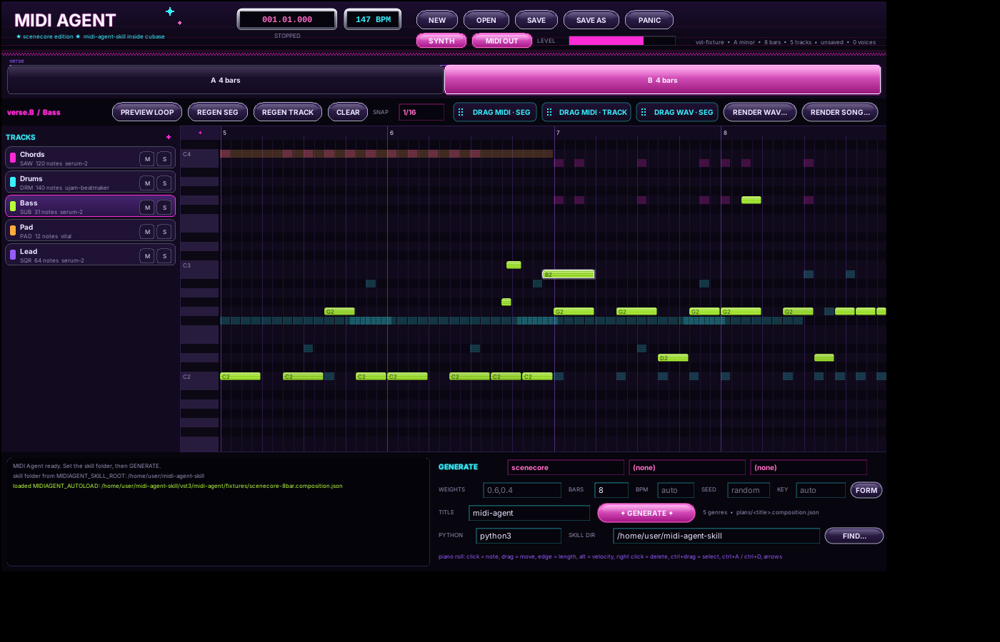

# MIDI Agent VST3

A VST3 instrument for Cubase that puts the `midi-agent-skill` composition
engine inside the DAW. It generates songs with the Python pipeline, shows an
editable piano roll for each segment, plays the result in sync with the host,
and hands segments to the DAW as `.mid` or `.wav` files by drag and drop.



## What it does

| Area | What you get |
|---|---|
| Generate | Pick up to three genre profiles, weights, bars, BPM, key, seed, title. The plug-in runs `skills/compose_from_profile.py` on a worker thread and loads the composition it writes. |
| Segments | Every leaf section of the composition (`verse.A`, `chorus1.drop`, ...) is a segment tile. A song without sections is cut into 4 bar segments. |
| Piano roll | One segment of one track, editable: add, move, resize, delete, select, transpose, nudge, duplicate, velocity. The other tracks are drawn as ghosts. |
| Regenerate | `REGEN SEG` and `REGEN TRACK` call `--resume ... --regenerate <segment> [--layers <role>]` with a new seed. Your edits in the other segments stay. |
| Playback | Follows the host transport (position, tempo, play, stop, loop jumps). `PREVIEW LOOP` loops the selected segment on an internal clock while the transport is stopped. |
| Sound | A built-in sketch synth (saw, square, pluck, sub bass, pad, GM drums) so Cubase can `Render in Place` or `Export Audio Mixdown` the track to `.wav`. The notes also go to the plug-in's MIDI output bus, so any instrument track in Cubase can take its MIDI input from `MIDI Agent`. |
| Export | `DRAG MIDI · SEG`, `DRAG MIDI · TRACK` and `DRAG WAV · SEG` are drag sources: press, drag onto a Cubase track, release. `RENDER WAV...` and `RENDER SONG...` write a `.wav` through a save dialog. `SAVE` writes the composition JSON the Python pipeline understands. |
| Look | Y2K chrome, magenta and cyan neon, scanlines, sparkles. See `docs/UI-STYLE.md`. |

Everything the plug-in writes is in Cubase's units: 480 ticks per quarter
note, bars and beats. Seconds never appear in a musical position.

## Layout of this folder

```
vst3/midi-agent/
├── CMakeLists.txt          core library + tests + the VST3 target
├── core/                   host independent C++: JSON, composition model, segments,
│                           MIDI and WAV writers, synth, sequencer, renderer, Python bridge
├── source/                 the plug-in: processor, controller, editor, factory
│   └── ui/                 theme + custom VSTGUI views (piano roll, segment strip, ...)
├── tests/                  unit tests (core) + host_smoke (loads the built .vst3)
├── fixtures/               a composition generated by the skill (scenecore, 8 bars)
├── resource/               Windows version resource
├── scripts/                build and screenshot helpers
└── docs/                   BUILD, ARCHITECTURE, STATUS, UI-STYLE, AGENT-GUIDE, screenshots
```

## Build

Short version. The full procedure is in `docs/BUILD.md`.

```powershell
# Windows, from the repository root, with VS 2022 Build Tools and CMake installed
cmake -S vst3/midi-agent -B build/midi-agent -G "Visual Studio 17 2022" -A x64 `
      -DSMTG_VST3_SDK_DIR=X:/AI-2/Steinberg-VST-factory/vst3sdk
cmake --build build/midi-agent --config Release
ctest --test-dir build/midi-agent -C Release
# result: build/midi-agent/VST3/Release/MIDI Agent.vst3  ->  copy to C:\Program Files\Common Files\VST3\
```

```bash
# Linux (compile check, tests, screenshots)
cmake -S vst3/midi-agent -B build/midi-agent -DSMTG_VST3_SDK_DIR=/path/to/vst3sdk
cmake --build build/midi-agent -j
ctest --test-dir build/midi-agent
```

## First run in Cubase

1. Add an instrument track with `MIDI Agent`.
2. Open the editor. In the `GENERATE` panel set `PYTHON` to your Python
   executable (`python` is the Windows launcher) and `SKILL DIR` to the folder
   that holds `SKILL.md` (`FIND...` lets you pick `SKILL.md`). Both are saved
   with the project. The environment variables `MIDIAGENT_SKILL_ROOT` and
   `MIDIAGENT_PYTHON` set machine wide defaults.
3. Pick a genre and press `GENERATE`. The log at the bottom shows the exact
   command line and the pipeline output.
4. Press play in Cubase. The track plays through the built-in synth and sends
   MIDI on its output bus.
5. Drag `DRAG MIDI · SEG` onto another track, or `Render in Place` the
   instrument track for a `.wav`.

## Status

The core library has 34 unit tests, the built plug-in passes Steinberg's
validator (47 tests) and a headless host smoke test (process loop, MIDI out,
audio, preview loop, state round trip), and the editor was driven with real
mouse events under a virtual X server. It has **not** been loaded in Cubase
yet. `docs/STATUS.md` lists what is verified and what is open.
